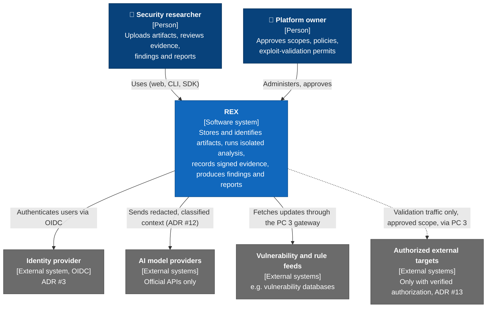
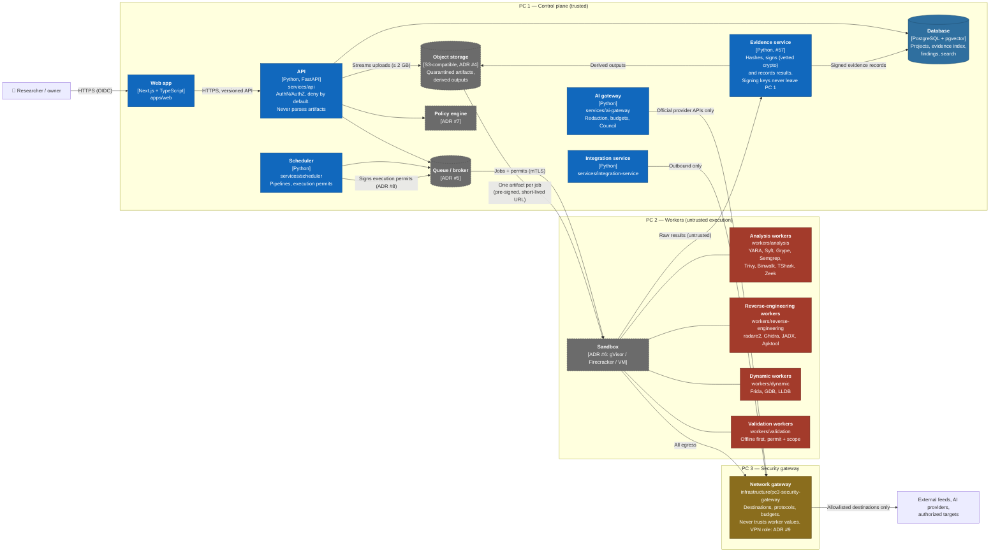

# REX architecture overview

REX is an AI-assisted reverse-engineering and security-research platform. Users upload **untrusted** artifacts (binaries, APK/IPA, firmware, PCAPs, source code). REX stores and identifies them safely, runs analysis tools in isolated sandboxes, records **signed evidence**, uses a multi-model AI *Council* to help interpret results, and produces findings and reports.

> **AI is a helper, never proof. Evidence is proof.** A finding must link to evidence; AI claims or Council agreement alone are never enough.

This page shows the target architecture as [C4](https://c4model.com/) diagrams (level 1: context, level 2: containers). Diagrams use Mermaid `flowchart` with C4 notation because Mermaid's dedicated C4 diagram type is still experimental. Boxes marked **ADR #N** are deliberately open decisions: they are drawn by role only, and the technology is chosen in that ADR, never assumed here.

## Level 1 — System context

## Level 2 — Containers on the 3-PC lab

The lab is three machines with separate trust levels. Untrusted content is never parsed or executed in the control plane. Workers hold no control-plane credentials and no signing keys: they get per-job, short-lived, pre-signed access to one artifact and return raw results; a trusted evidence service on PC 1 hashes, signs and records them. All worker network traffic goes through PC 3, which never trusts worker-supplied values.

## Trust boundaries and the rules they enforce

Rule numbers refer to the hard rules in `CLAUDE.md` (added with #35).

| Boundary | What crosses it | Rules that apply (CLAUDE.md) |
|---|---|---|
| User ↔ API | Uploads, requests | 3 deny-by-default authorization per project + operation; 4 max 2 GB, content-based identification |
| API ↔ object storage | Raw artifacts | 2 API never parses or executes untrusted content; 10 per-project isolation |
| Control plane (PC 1) ↔ workers (PC 2) | Jobs, execution permits, raw results | 1 tool output is untrusted; 5 extraction limits; workers hold no control-plane credentials or signing keys |
| Workers (PC 2) ↔ gateway (PC 3) ↔ internet | All network traffic | 6 no external targets without verified authorization; 7 gateway enforces destinations, protocols, budgets |
| Platform ↔ AI providers | Classified, redacted context | 8 AI is never proof; 9 no secrets in prompts; 12 official provider APIs only |
| Evidence service (PC 1) | Raw results in, signed records out | 8 findings link to evidence; 11 vetted crypto only; signing happens only in the trusted zone |

The detailed threat model is tracked in #40.

## Where things live

| Area | Path |
|---|---|
| Web app | `apps/web` |
| Control-plane services | `services/{api,scheduler,ai-gateway,integration-service}` |
| Workers | `workers/{analysis,dynamic,reverse-engineering,validation}` |
| Shared contracts and SDKs | `packages/{contracts,python-sdk,typescript-sdk,cli,plugin-sdk,tool-adapters,shared-config}` |
| Infrastructure | `infrastructure/{compose,k3s,pc1-control-plane,pc2-workers,pc3-security-gateway,monitoring,backup-recovery}` |
| Decisions | [`docs/adr/`](../adr/README.md) |

Service boundaries: no service imports another service's private code; shared types live only in `packages/contracts`.

## Open decisions shown on these diagrams

| Element | Decision issue |
|---|---|
| Identity provider | #3 |
| Object storage product | #4 |
| Message broker | #5 |
| Sandbox technology | #6 |
| Policy engine | #7 |
| Execution-permit signing and revocation | #8 |
| PC 3 VPN role | #9 |
| AI data classification and redaction | #12 |
| External-target authorization proof | #13 |
